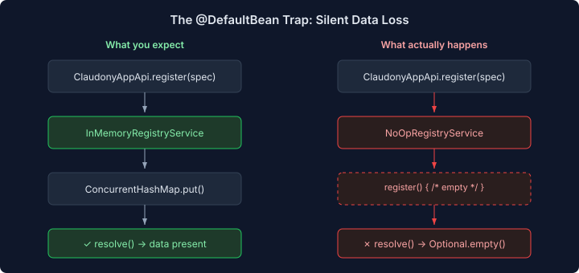
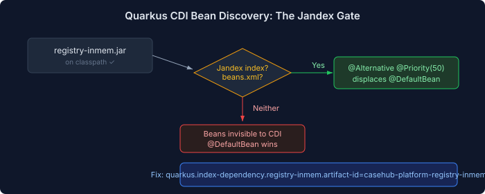
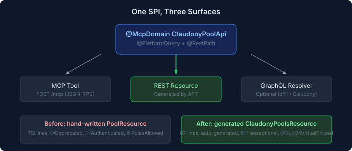

# The Beans Quarkus Can't See

A fleet registration API that silently eats your data. A JAR on the classpath whose beans don't exist. Config properties that nothing consumes but Quarkus won't let through. Five bugs in Claudony's startup and persistence layer, all rooted in the same thing: Quarkus CDI wiring that looks correct but isn't.

## The Registration That Went Nowhere

The bug report was precise: `registerApp(spec)` returns HTTP 200, then `getApp(applicationId)` returns empty. The ops topology tests saw every deployment succeed, then every status check report ABSENT. The data vanished between write and read.

Claude traced the call chain — both `registerApp()` and `getApp()` flow through the same `RegistryService` CDI bean. The question was which implementation was injected.

The answer: `NoOpRegistryService`. A `@DefaultBean` from `platform-core` with a `register()` method whose body is literally empty. No exception, no log line, no indication. The void return type means the caller has no way to know the data was discarded.

```java
// NoOpRegistryService — the default that eats your data
public void register(RegistryEntry entry) {
    // empty
}

public Optional<RegistryEntry> resolve(String id) {
    return Optional.empty();
}
```

The real implementation — `InMemoryRegistryService` — was sitting in `casehub-platform-registry-inmem.jar`, correctly annotated as `@Alternative @Priority(50)`, produced by a `@Produces` method in `RegistryInmemBeans`. In CDI 4.0, an `@Alternative` with `@Priority` auto-activates. It should have displaced the `@DefaultBean` without any configuration.

It didn't. The JAR was on the classpath. The annotations were correct. The priority was set. And Quarkus couldn't see any of it.



## The Jandex Gate

Quarkus doesn't scan every JAR on the classpath for CDI beans. It scans JARs that have a Jandex index (`META-INF/jandex.idx`) or a `beans.xml`. Without either, the JAR might as well not exist for CDI purposes.

`casehub-platform-registry-inmem.jar` had neither.

```bash
$ jar tf registry-inmem.jar | grep -E "jandex|beans.xml"
# (nothing)
```

The fix is one property:

```properties
quarkus.index-dependency.registry-inmem.group-id=io.casehub
quarkus.index-dependency.registry-inmem.artifact-id=casehub-platform-registry-inmem
```

That's it. Once Quarkus can see the JAR's classes, it discovers `RegistryInmemBeans`, finds the `@Alternative @Priority(50)` producer, and the `@DefaultBean` yields. Registrations persist. Reads return data.



The pattern is worth internalising: `@DefaultBean` is a safety net, not a feature toggle. When a no-op `@DefaultBean` exists for an SPI, and the real implementation is in a separate JAR, the Jandex index is the gate between working and silently broken. There's no error, no warning, no startup failure. The system just does nothing, successfully.

## Killing the Hand-Written REST Layer

The same session cleaned up another kind of invisible debt. Claudony had nine `@McpDomain` SPI classes defining its API surface — pools, sessions, peers, fleet, apps, registry, ops, mesh, cases. The `GraphQLResolverProcessor` APT generates full JAX-RS REST resources from these SPIs at compile time. One interface, three surfaces: MCP tool, REST endpoint, optional GraphQL resolver.



But three of the original hand-written REST resources were still on the classpath. `PoolResource` and `AgentPoolResource` at their legacy paths (`/api/pools`, `/api/agent-pools`), both marked `@Deprecated(forRemoval = true)`. A `FleetResource` at the same path as the generated `ClaudonyFleetResource`, accepting `text/plain` YAML where the generator mapped it as `@QueryParam`.

The deprecated ones were dead weight — the generated resources at `/api/claudony/pools` handled everything. Deleting them also deleted `CapacityUpdate`, `ScalingConfigUpdate`, and `CredentialRoleAugmentorTest` — all exclusively tied to the old endpoints. 342 lines gone, nothing lost.

The `FleetResource` was different. It legitimately accepts raw YAML as a request body, which the generator can't express — unannotated `String` parameters get mapped to `@QueryParam` by convention. The fix was to remove `claudony/fleet` from the generator's `domainFilter`, letting the hand-written resource serve REST while the `@McpDomain` class still provides MCP tools.

## Orphan Properties

The config validation failures were the least interesting bugs and the most instructive.

```
SRCFG00050: casehub.qhorus.enabled does not map to any root
SRCFG00050: casehub.qhorus.reactive.enabled does not map to any root
```

Two properties in `application.properties` that nothing consumed. `QhorusConfig` has nested interfaces for `a2a`, `watchdog`, and `cleanup` — but no top-level `enabled()` method, and no `reactive` sub-interface. The properties were orphans from a time when someone expected those config keys to exist. They never did.

A third — `claudony.eidos.pool-bridge.enabled=false` — was more subtle. The `EidosPoolBridge` class uses `@IfBuildProperty(name = "claudony.eidos.pool-bridge.enabled", stringValue = "true")`. When the property is `false`, the bean is excluded at build time. Its `@ConfigProperty` annotations never register. Quarkus sees the property in the file but can't map it to anything.

The fix for the first two: delete the lines. The fix for the third: also delete the line. `@IfBuildProperty` checks whether the property equals `"true"`. An absent property doesn't match — the bean stays excluded, and there's nothing for Quarkus to complain about.

## The Lesson

Every one of these bugs had the same shape: something looked correct from the outside but was silently wrong underneath. The registration API returned 200. The JAR was on the classpath. The config file had the property. And in each case, the failure mode was *nothing happening* — no exception, no log, no visible error. Just absent data, absent beans, absent config roots.

Quarkus is opinionated about wiring, and that's a strength. But when the wiring fails silently — when a `@DefaultBean` swallows your writes, or a missing index hides your `@Alternative` — the debugging surface is just "it doesn't work." The fix is always small. Finding it is the whole problem.
