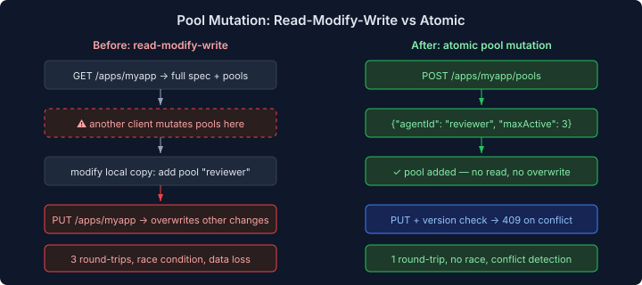
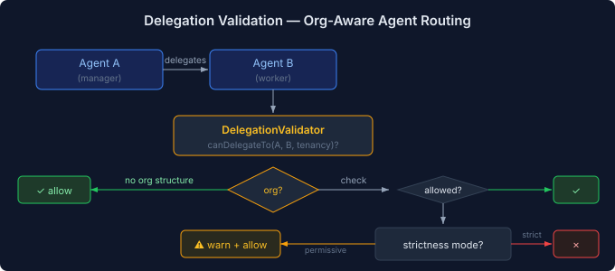

# Making the Fleet API Real

There's a phase in every platform's life where the APIs work but only for the people who built them. The happy path is solid. The edge cases are someone else's problem. Then an external consumer shows up — in this case, casehub-ops — and the gaps become obvious.

Claudony's fleet API had three: pool mutations required rewriting the entire app spec, updates had no conflict detection, and agent delegation had no structural validation. Each gap is small. Together they made the API unusable for automated deployment.

## The Read-Modify-Write Tax

The ops topology planner deploys applications with pools. Until today, adding a pool to an existing application meant:

1. `GET /apps/myapp` — fetch the full spec including all pools
2. Modify the local copy — append the new pool
3. `PUT /apps/myapp` — write the entire spec back

Three round-trips. A race window between read and write. And the silent overwrite problem: if another client modified the spec between your read and your write, their changes vanish without a trace. No error, no conflict, no indication.

This pattern exists because `ApplicationSpec` models pools as a nested list. The spec is the unit of mutation — you can't touch a single pool without rewriting the whole thing. That's fine when one client owns the lifecycle. It breaks when two deployment planners target the same application concurrently, which is exactly what happens in multi-environment topology deployments.



The fix was three new endpoints:

```java
@PlatformMutation("Add a pool to an application")
@RestPath("/{name}/pools")
public AppPoolInfo addPool(@PathParam String name, PoolSpec pool)

@PlatformMutation("Update a pool's capacity")
@RestPath("/{name}/pools/{agentId}")
public AppPoolInfo updatePool(@PathParam String name,
                               @PathParam String agentId, PoolSpec pool)

@PlatformMutation("Remove a pool from an application")
@RestPath("/{name}/pools/{agentId}/remove")
public void removePool(@PathParam String name, @PathParam String agentId)
```

One round-trip. No read. No overwrite. Pool IDs use the existing composite format (`appName/agentId`), so the service layer changes were minimal — three methods on `ApplicationRegistrationService` that resolve the app, validate the pool exists or doesn't, and delegate to `AgentPoolDefinitionRegistry`.

## Version Checks Without a Schema Change

The read-modify-write problem has a companion: even when you use the full-spec `PUT`, there's no way to detect that someone else changed the spec between your read and your write. The registry has no version field, so every write is an unconditional overwrite.

The clean solution would be a `version` field on `RegistryEntry` in platform-api, with compare-and-swap semantics in the registry implementation. That's a cross-repo change that touches the SPI contract.

The pragmatic solution: store version as a metadata field. `register()` writes `_version=1`. `update()` reads it, increments it, writes the new value. If the client sends `expectedVersion` in the spec and it doesn't match the stored version, the service throws 409 Conflict.

```java
long currentVersion = Long.parseLong(
    existing.metadata().getOrDefault("_version", "0"));

if (spec.expectedVersion() != null
    && spec.expectedVersion() != currentVersion) {
    throw new WebApplicationException(
        "Version conflict: expected " + spec.expectedVersion()
            + " but current is " + currentVersion,
        Response.Status.CONFLICT);
}
```

It's not enforced at the registry level — a direct `registryService.register()` call bypasses the check. But every consumer goes through `ApplicationRegistrationService`, which does enforce it. Good enough for the current architecture, and it's backward compatible: clients that don't send `expectedVersion` get unconditional writes, same as before.

`ApplicationInfo` gained a `version` field so clients can read the current version and pass it back on update. The 9-arg constructor delegates to the new 10-arg one with `version=0`, so existing callers don't break.

## Delegation: Who Can Ask Whom

The third gap was more architectural. When a case engine provisions a new worker — say a code reviewer agent to assist a developer agent — there's nothing validating whether that delegation is structurally appropriate. The `delegation` flag on an agent's disposition says *can delegate*, not *can delegate to whom*.

Eidos defines org structures: teams, reporting lines, capability hierarchies. `OrgAwareDispatch.canDelegateTo(fromAgentId, toAgentId, tenancyId)` checks whether the org structure permits the delegation. A manager can delegate to their subordinates. Peers can't delegate to each other unless the structure explicitly allows it.



`DelegationValidator` wraps this check with a strictness policy:

- **Permissive** (default): logs a warning but allows delegation outside org scope. This preserves current behaviour — nothing breaks when the validator is added.
- **Strict**: rejects the delegation. The provisioner gets a `false` and can refuse to create the worker.

The validator uses `Instance<OrgAwareDispatch>` injection, so it works without eidos-runtime on the classpath. When no `OrgAwareDispatch` bean is resolvable — which is the case in standalone claudony deployments without an org structure — every delegation is allowed. The validation only activates when there's an org structure to validate against.

The provisioner integration isn't wired yet. `ProvisionContext` doesn't carry a `fromAgentId` — the triggering agent's identity isn't available at the provisioning layer without a ledger lookup. That's engine-side work. The validator exists, the config exists, the tests prove it works across all four paths (no org, subordinate, non-subordinate permissive, non-subordinate strict). The wiring comes when the engine provides the context.

## Why This Matters

Three small features, each under 50 lines of service code. But they shift the API from "works for the builder" to "works for consumers." Atomic pool mutations mean deployment planners don't need distributed locking. Version checks mean concurrent updates produce a clear error instead of silent data loss. Delegation validation means agent orchestration can enforce structural constraints instead of hoping agents stay in their lane.

The pattern repeats in every platform I've worked on. The API that works for one client is a different thing from the API that works for many. The gap is always the same: conflict detection, fine-grained mutation, and structural validation. You never need them until you do, and then you need all three at once.
